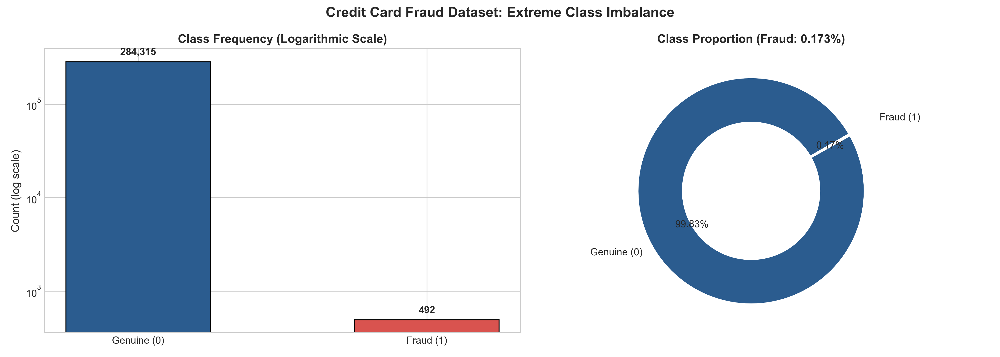
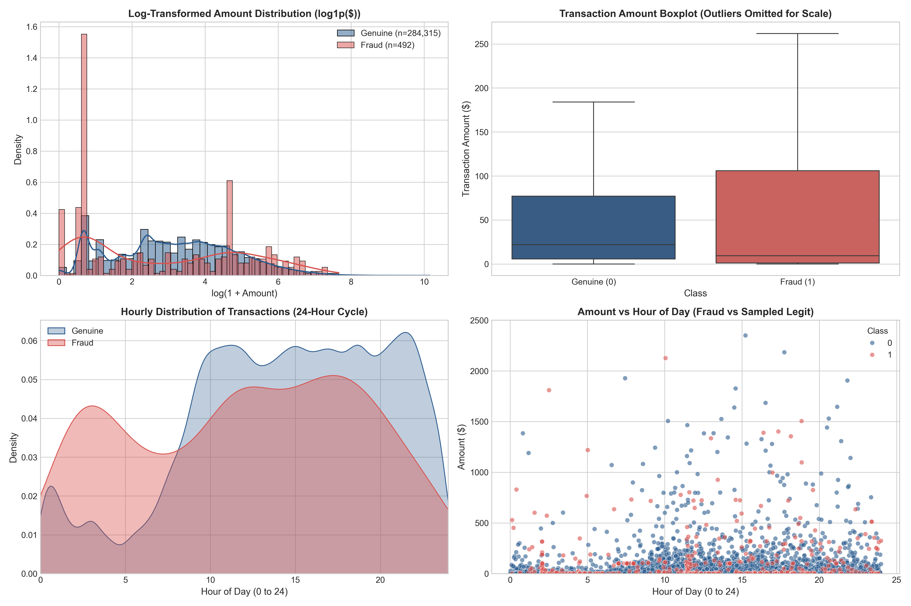
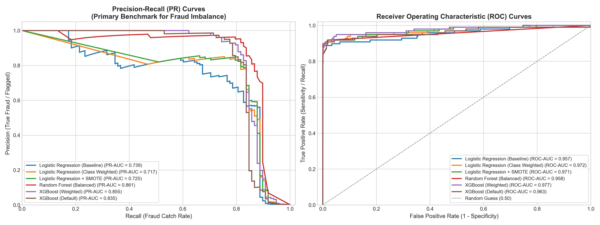
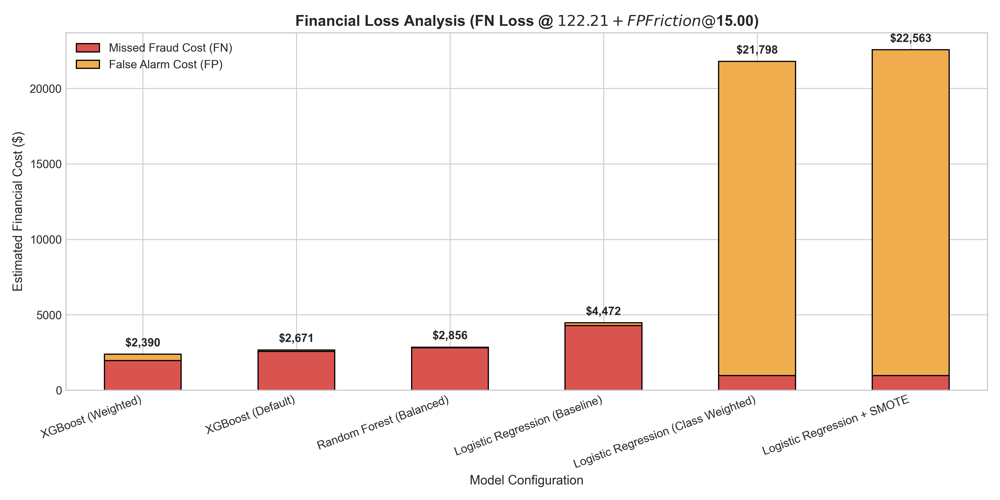

# 💳 Credit Card Fraud Detection: Benchmarking Imbalanced Learning & Cost-Sensitive Classification

[](https://www.python.org/)
[](https://scikit-learn.org/)
[](https://xgboost.readthedocs.io/)
[](https://imbalanced-learn.org/)
[](LICENSE)

An end-to-end, production-grade machine learning project investigating **extreme class imbalance** (0.17% fraud rate) in credit card transaction data. This project benchmarks six distinct modeling paradigms across linear models and tree ensembles, evaluates them using **Precision-Recall AUC (PR-AUC)**, and simulates operational financial losses caused by False Negatives (stolen funds) versus False Positives (customer friction).

---

## 📌 Executive Summary & Key Results

In credit card fraud detection, a naive classifier predicting every transaction as legitimate achieves **99.83% accuracy**, yet is completely ineffective in production. The objective is to maximize fraud detection while minimizing false alerts.

### 🏆 Benchmark Comparison (56,962 Hold-Out Transactions, 98 Frauds)

| Model Architecture | Strategy / Handling | PR-AUC | ROC-AUC | Recall (Catch Rate) | Precision | F1-Score | False Alarms (FP) | Missed Frauds (FN) |
| :--- | :--- | :---: | :---: | :---: | :---: | :---: | :---: | :---: |
| 🥇 **Random Forest** | `balanced_subsample` | **0.8610** | 0.9580 | 76.53% | **96.15%** | **0.8523** | **3** | 23 |
| 🥈 **XGBoost** | `scale_pos_weight = 577.3` | **0.8553** | **0.9771** | **83.67%** | 73.87% | 0.7847 | 29 | 16 |
| 🥉 **XGBoost** | Default (PR-AUC Metric) | **0.8353** | 0.9634 | 78.57% | 91.67% | 0.8462 | 7 | 21 |
| **Logistic Regression** | Baseline | 0.7388 | 0.9572 | 64.29% | 82.89% | 0.7241 | 13 | 35 |
| **Logistic Regression** | SMOTE Oversampling | 0.7251 | 0.9712 | 91.84% | 5.89% | 0.1106 | 1,439 | 8 |
| **Logistic Regression** | `class_weight='balanced'` | 0.7175 | 0.9720 | 91.84% | 6.09% | 0.1142 | 1,388 | 8 |

### 💡 Core Machine Learning Takeaways
1. **Precision-Recall AUC vs. ROC-AUC**: In extreme imbalance, ROC-AUC gives an overly optimistic picture (all models scored > 0.95 ROC-AUC). PR-AUC isolated real predictive power, separating weak linear models (~0.72) from robust ensembles (>0.85).
2. **The Danger of Naive Oversampling**: Applying SMOTE or class weighting to linear models bumped fraud recall to **91.84%**, but plummeted precision to **~5.9%**, inundating operations with **over 1,300 false alarms**.
3. **The Champion Architecture**: **Balanced Random Forest** achieved the best overall PR-AUC (**0.8610**) and F1-score (**0.8523**) with near-zero false alarms (only 3 out of 56,864 genuine transactions flagged). When higher fraud recall is prioritized by risk tolerance, **Weighted XGBoost** caught **83.67%** of frauds with high precision (73.87%).

---

## 📊 Visualizations & Performance Analysis

### 1. The Imbalance Problem & 24-Hour Transaction Cycles
The dataset contains **284,807 transactions** collected over 48 hours, with only **492 fraud cases (0.17%)**. Fraudulent transactions show significant temporal divergence, peaking during off-peak night/early morning hours.

| Extreme Class Imbalance | Amount & Time Distributions |
| :---: | :---: |
|  |  |

### 2. Precision-Recall & ROC Curves
Precision-Recall curves provide the most reliable benchmark under severe class imbalance because they directly reflect the trade-off between finding all frauds (Recall) and ensuring flagged transactions are actually fraud (Precision).



### 3. Confusion Matrices & Error Breakdown
Comparing the error distribution across models illustrates the fundamental trade-off: catching more frauds vs. false positive customer friction.


### 4. Financial Cost-Benefit Simulation
In real banking systems, errors carry asymmetrical costs:
- **False Negative (Missed Fraud)**: \$122.21 direct financial loss (dataset average fraud amount).
- **False Positive (False Alarm)**: \$15.00 operational review and customer friction cost.



---

## 🛠️ Project Structure

```bash
credit-card-fraud-detection/
├── .gitignore                      # Excludes raw data (>100MB) & compiled caches
├── LICENSE                         # MIT Open Source License
├── README.md                       # Project documentation & benchmark analysis
├── requirements.txt                # Pinned dependencies
├── main.py                         # Single-command end-to-end execution pipeline
├── data/
│   ├── README.md                   # Data source & download instructions
│   └── creditcard.csv              # (Excluded from Git; download instructions provided)
├── notebooks/
│   └── credit_card_fraud_detection.ipynb  # Interactive analysis & narrative walkthrough
├── src/
│   ├── __init__.py
│   ├── eda.py                      # Exploratory data analysis & statistical summaries
│   ├── model.py                    # Stratified splitting, scaling & model training
│   └── evaluate.py                 # Visualizations, PR/ROC curves & cost simulation
├── models/
│   ├── best_fraud_model.joblib     # Serialized best-performing model
│   ├── scaler_amount.joblib        # Preprocessing RobustScaler for Amount
│   └── scaler_time.joblib          # Preprocessing RobustScaler for Time
└── reports/
    ├── model_metrics.json          # Cached metric values
    ├── curves_data.json            # PR & ROC curve points
    └── figures/                    # High-resolution saved plots
        ├── 01_class_imbalance.png
        ├── 02_amount_and_time_analysis.png
        ├── 03_feature_correlations.png
        ├── 04_top_predictive_features_boxplot.png
        ├── 05_pr_and_roc_curves.png
        ├── 06_metrics_comparison_bar.png
        ├── 07_confusion_matrices_grid.png
        └── 08_financial_cost_analysis.png
```

---

## 🚀 Quickstart & Reproducibility

### 1. Clone the Repository
```bash
git clone https://github.com/<your-username>/credit-card-fraud-detection.git
cd credit-card-fraud-detection
```

### 2. Set Up Virtual Environment & Dependencies
```bash
python -m venv .venv

# On Windows:
.venv\Scripts\activate

# On macOS/Linux:
source .venv/bin/activate

pip install -r requirements.txt
```

### 3. Download the Dataset
Download via Kaggle CLI:
```bash
kaggle datasets download -d mlg-ulb/creditcardfraud -p data --unzip
```
*(Or manually place `creditcard.csv` in the `data/` directory from the [Kaggle Dataset Page](https://www.kaggle.com/datasets/mlg-ulb/creditcardfraud)).*

### 4. Run the Pipeline
Execute the full EDA, model training, benchmarking, and figure generation in one command:
```bash
python main.py
```

Or open the interactive Jupyter Notebook:
```bash
jupyter notebook notebooks/credit_card_fraud_detection.ipynb
```

---

## 🔬 Methodology & Best Practices

1. **Stratified Sampling**:
   Random train/test splits risk varying fraud ratios. We implemented a 5-fold `StratifiedKFold` and an 80/20 stratified hold-out split, guaranteeing that exactly 0.17% of every partition is fraudulent.
2. **Robust Scaling without Data Leakage**:
   Transaction `Amount` and `Time` exhibit significant skew and high-value outliers. We employed `RobustScaler` (scaling by median and IQR). To prevent data leakage, scalers were fitted solely on the training splits and applied downstream to test sets.
3. **Resampling Inside Pipelines**:
   SMOTE was encapsulated inside `imblearn.pipeline.Pipeline`, ensuring synthetic samples were generated exclusively inside cross-validation training folds and never leaked into evaluation data.
4. **Evaluation Beyond Accuracy**:
   Evaluated algorithms using Average Precision (PR-AUC), balanced F1-score, and custom financial loss modeling.

---

## 📜 License
This project is open-source and available under the [MIT License](LICENSE).
