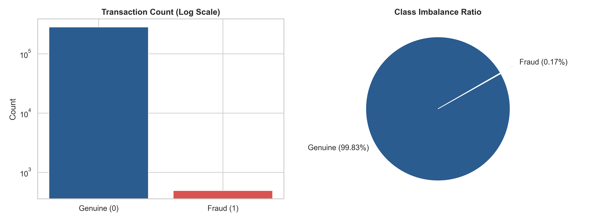
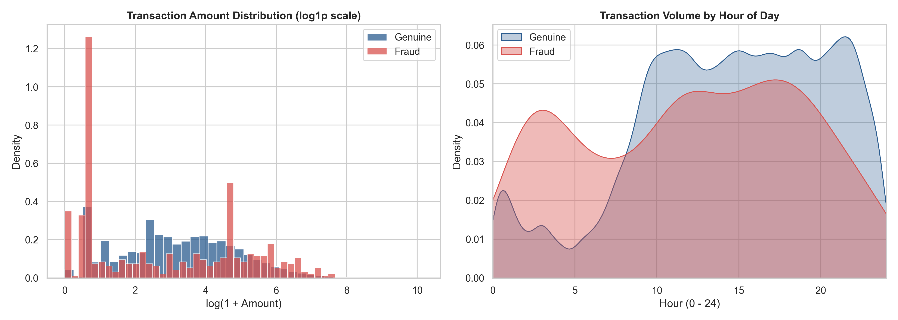
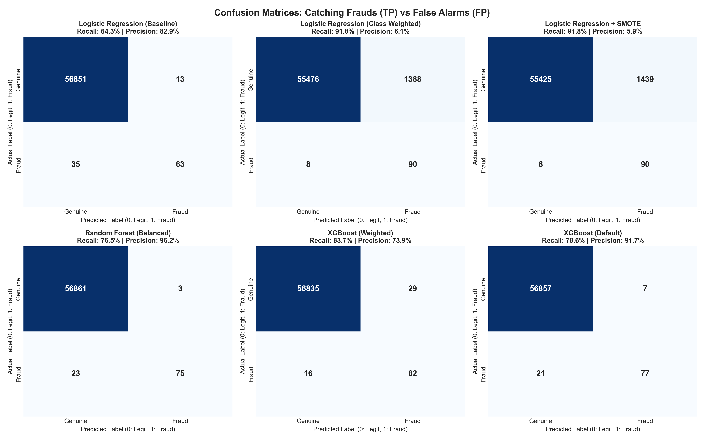

# Credit Card Fraud Detection

A machine learning project exploring how to detect fraudulent credit card transactions in a severely imbalanced dataset (only **0.17%** of transactions are fraud).

---

## Why I Built This

Most tutorial machine learning projects work with balanced datasets where 50% of the data is class A and 50% is class B. In the real world—especially in financial services and cybersecurity—fraud is rare.

In this Kaggle dataset of **284,807 transactions**, only **492 are fraudulent**.

If you train a dumb model that predicts "legitimate" for every single transaction, it gets **99.83% accuracy**. On paper, that looks amazing. In reality, it caught **zero fraud** and lost money.

I built this project to understand:
1. Which evaluation metrics to actually trust when accuracy lies to you.
2. How different algorithms handle extreme imbalance without generating hundreds of false alarms.
3. How to properly preprocess and scale data without leaking future information into the test set.

---

## What the Data Looks Like

The dataset contains credit card transactions made by European cardholders in September 2013 over two days. Features `V1` to `V28` were transformed with PCA by the original researchers for customer privacy. The only non-transformed features are `Time` and `Amount`.

### 1. Extreme Class Imbalance
Only 1 out of every ~578 transactions is fraud:



### 2. Transaction Amount and Time Patterns
- **Amounts**: Fraudulent transactions have a lower median ($9.25) than legitimate ones ($22.00), but a higher average ($122.21). Fraudsters often test stolen cards with small amounts first or make targeted mid-sized purchases.
- **Time**: Fraudulent transactions show a noticeable uptick during late-night and early-morning hours when users are asleep and less likely to notice instant bank SMS alerts.



---

## Methodology & Decisions

1. **Stratified Train/Test Split (80/20)**  
   A random train/test split could accidentally leave too few frauds in one of the sets. I used `stratify=y` to ensure both the training set and testing set retain the exact same 0.17% fraud prevalence.
   - Training set: 227,845 transactions (394 frauds)
   - Test set: 56,962 transactions (98 frauds)

2. **No Data Leakage Scaling (`RobustScaler`)**  
   The `Amount` feature has extreme values (ranging from $0.00 up to $25,691). `RobustScaler` scales data using the median and interquartile range (IQR), making it resistant to extreme outliers. The scaler was fit strictly on the training set and only transformed the test set.

3. **Metrics That Actually Matter**  
   - **Recall**: Out of all real fraud cases, how many did we catch?
   - **Precision**: When the model flags a transaction, is it actually fraud, or did we just freeze an innocent customer's card?
   - **PR-AUC (Precision-Recall AUC)**: The single best overall metric for imbalanced problems, measuring the trade-off across all probability thresholds.

---

## Results & Comparison

I evaluated three distinct models on the 56,962 unseen hold-out transactions:

| Model | PR-AUC | ROC-AUC | Recall (Fraud Caught) | Precision | F1-Score | False Alarms (FP) | Missed Frauds (FN) |
| :--- | :---: | :---: | :---: | :---: | :---: | :---: | :---: |
| **Random Forest (Balanced)** | **0.8610** | 0.9580 | 76.53% | **96.15%** | **0.8523** | **3** | 23 |
| **XGBoost (Weighted)** | **0.8553** | **0.9771** | **83.67%** | 73.87% | 0.7847 | 29 | 16 |
| **Logistic Regression (Baseline)** | 0.7388 | 0.9572 | 64.29% | 82.89% | 0.7241 | 13 | 35 |

### Precision-Recall & ROC Curves
Notice how in the ROC curve on the right, every model looks close to perfect (>0.95). But the Precision-Recall curve on the left reveals the truth: tree ensembles clearly outperform linear baselines.


### Confusion Matrix Breakdown
Seeing the raw counts makes the trade-off clear:



- **Random Forest (Balanced)** was the most precise model. Out of 56,864 legitimate transactions, it only raised **3 false alarms**, while catching **75 out of 98 frauds**.
- **XGBoost (Weighted)** was the best at catching fraud. It caught **82 out of 98 frauds (83.67% recall)** with 29 false alarms.

---

## What I Learned

1. **ROC-AUC is misleading on imbalanced datasets**: Because the negative class is huge (56,864 genuine transactions), a model can make hundreds of false alarms and still boast a 0.97 ROC-AUC. PR-AUC is much more honest.
2. **There is always a trade-off between customer friction and loss prevention**:
   - If your bank has zero tolerance for fraud loss, you want high recall (like XGBoost).
   - If your bank prioritizes customer experience and hates declining valid transactions, you want high precision (like Balanced Random Forest).
3. **Data hygiene matters**: Fitting scalers or resampling techniques on the whole dataset before splitting is a common mistake that gives artificially high scores. Always split first, fit on train, and apply to test.

---

## Project Structure

```
credit-card-fraud-detection/
├── .gitignore               # Ignores large raw CSV files & Python cache
├── LICENSE                  # MIT License
├── README.md                # Project documentation and findings
├── requirements.txt         # Minimal Python dependencies
├── fraud_detection.ipynb    # Clean walkthrough notebook
├── eda.py                   # Simple script for stats and data charts
├── train.py                 # Simple script to train and evaluate models
└── images/                  # Generated plots for README
    ├── class_imbalance.png
    ├── amount_and_time.png
    ├── pr_and_roc_curves.png
    └── confusion_matrices.png
```

---

## How to Run It Locally

### 1. Clone the repository
```bash
git clone https://github.com/JamiuDahunsi/credit-card-fraud-detection.git
cd credit-card-fraud-detection
```

### 2. Set up virtual environment & install requirements
```bash
python -m venv .venv

# On Windows:
.venv\Scripts\activate

# On Mac/Linux:
source .venv/bin/activate

pip install -r requirements.txt
```

### 3. Get the dataset
Download `creditcard.csv` from [Kaggle](https://www.kaggle.com/datasets/mlg-ulb/creditcardfraud) and place it inside a `data/` folder:
```bash
# If you have kaggle CLI:
kaggle datasets download -d mlg-ulb/creditcardfraud -p data --unzip
```

### 4. Run the code
- To run EDA:
  ```bash
  python eda.py
  ```
- To train and evaluate models:
  ```bash
  python train.py
  ```
- Or open the interactive notebook:
  ```bash
  jupyter notebook fraud_detection.ipynb
  ```

---

## License
MIT License. Feel free to use this code for learning or building your own models.
